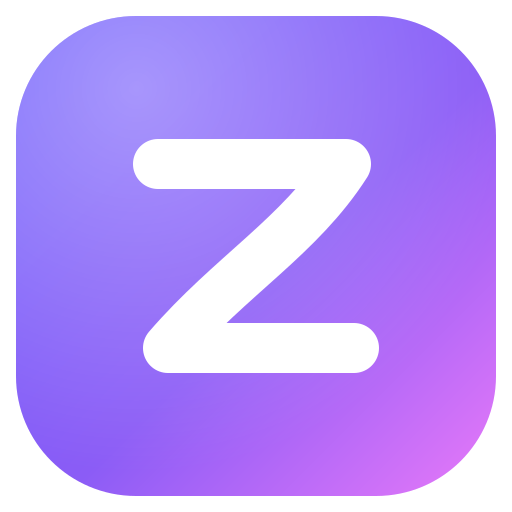

  

<h1 align="center">Kaze 風</h1>

  Navegador basado en Firefox (Gecko) para <b>Windows</b> y <b>Android</b>. 
  Rápido, ligero en RAM y con todo conectado entre dispositivos.

---

## ¿Qué es Kaze?

Kaze ("viento" en japonés) es un navegador inspirado en [Zen Browser](https://github.com/zen-browser/desktop):
pestañas verticales, espacios de trabajo, vista dividida y una interfaz limpia — pero con dos metas extra:

1. **Consumir poca memoria** — las pestañas que no usas se descargan solas, menos procesos en segundo plano y cachés más pequeñas.
2. **Estar en Windows y Android** — el mismo motor (Gecko) en ambos, con historial, marcadores, pestañas y contraseñas sincronizados.

## Estructura del repositorio

| Carpeta | Qué contiene |
|---|---|
| [`desktop/`](desktop/) | Kaze para Windows. Es una **capa encima de Zen**: un script descarga Zen, le aplica la marca y las optimizaciones de Kaze, y lo compila. Así recibimos cada actualización de Zen/Firefox sin mantener un fork gigante. |
| [`android/`](android/) | Kaze para Android. App en **Kotlin + Jetpack Compose** sobre **GeckoView** (el mismo motor de Firefox para Android). |
| [`shared/`](shared/) | Lo que comparten ambas plataformas: la paleta de diseño (colores, radios, animaciones). |
| [`branding/`](branding/) | Logo de Kaze y el script que genera todos los íconos (Windows `.ico`, PNGs, Android). |
| [`docs/`](docs/) | Arquitectura, plan de trabajo y guías de compilación. |

## Empezar

- **Android:** abre la carpeta `android/` en Android Studio y dale *Run*. O descarga el APK de la pestaña *Actions* (cada push compila uno). Ver [`android/README.md`](android/README.md).
- **Windows:** sigue [`desktop/README.md`](desktop/README.md). Compilar Firefox necesita un PC con bastante RAM (16 GB mínimo, 32 GB ideal) y unas horas la primera vez.

## Estado

🚧 Fase inicial. Ver el [plan de trabajo](docs/ROADMAP.md).

## Licencia

[Mozilla Public License 2.0](LICENSE), la misma de Firefox y Zen.
Kaze se apoya en el trabajo de [Zen Browser](https://github.com/zen-browser/desktop) y [Mozilla](https://www.mozilla.org/).
Kaze no está afiliado a ninguno de los dos.
