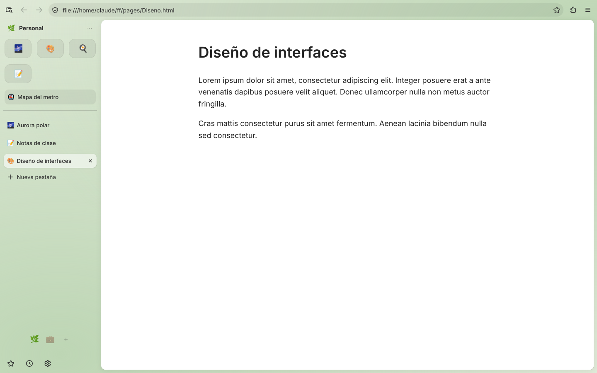

  

<h1 align="center">Kaze 風</h1>

  Navegador basado en Firefox para <b>Windows</b> y <b>Android</b>, con espacios, Essentials y poca RAM. 
  Hecho desde cero tomando como guía a <a href="https://github.com/zen-browser/desktop">Zen Browser</a>,
  con la estética de <a href="https://github.com/Kjell6/Z-Sync">Z-Sync</a>.

  
  &nbsp;
  

## Qué tiene

| | Windows | Android |
|---|---|---|
| Motor | Firefox 158 (Gecko) compilado como Kaze | GeckoView 158 (el Firefox de Android) |
| **Espacios** con emoji y degradado propio | ✅ barra lateral + selector abajo, `Ctrl+Alt+1…9` | ✅ deslizar a los lados + selector abajo |
| **Essentials** (fijadas en todos los espacios) | ✅ cuadrícula arriba | ✅ cuadrícula arriba |
| Pestañas fijadas por espacio + "Limpiar" | ✅ | ✅ |
| Pestañas que se duermen solas (ahorro de RAM) | ✅ tras 20 min + al faltar memoria | ✅ máx. 1–3 cargadas + tras 10 min + al faltar memoria |
| Modo compacto | ✅ `Ctrl+Alt+C` | — |
| Página "flotante" con bordes redondeados | ✅ | — |
| Espacios aislados (cookies propias, como contenedores) | con los contenedores de Firefox | ✅ |
| Bloqueo de rastreadores estricto, sin telemetría | ✅ | ✅ |
| Historial, búsqueda con sugerencias, privadas, descargas, buscar en página, versión de escritorio | ✅ (Firefox) | ✅ |
| Firefox Sync | ✅ | próxima fase |

## Estructura

| Carpeta | Qué hay |
|---|---|
| [`android/`](android/) | App Kotlin + Jetpack Compose sobre GeckoView. |
| [`desktop/`](desktop/) | Kaze para Windows: configuración de compilación de Firefox (con `surfer`, la herramienta de Zen), la interfaz de Kaze (`src/browser/kaze/`) y **solo 3 parches** a Firefox. |
| [`shared/design/`](shared/design/) | Colores y medidas comunes a las dos versiones. |
| [`branding/`](branding/) | Logo y generador de íconos. |
| [`docs/`](docs/) | [Arquitectura](docs/ARQUITECTURA.md), [plan de trabajo](docs/ROADMAP.md) y capturas. |

## Probar

- **Android:** pestaña *Actions* → último run de **Android** → *Artifacts* → `kaze-android-arm64-v8a`. O abre `android/` en Android Studio. Más en [`android/README.md`](android/README.md).
- **Windows, sin compilar:** el cargador de desarrollo pone la interfaz de Kaze sobre tu Firefox normal en un minuto. Ver [`desktop/README.md`](desktop/README.md#probar-sin-compilar).
- **Windows, compilado:** también en [`desktop/README.md`](desktop/README.md). Compilar Firefox pide un PC con 16 GB de RAM o más y unas horas la primera vez.

## Licencia

[Mozilla Public License 2.0](LICENSE), como Firefox y Zen. Kaze no está afiliado a Mozilla, a Zen Browser ni a Z-Sync.
