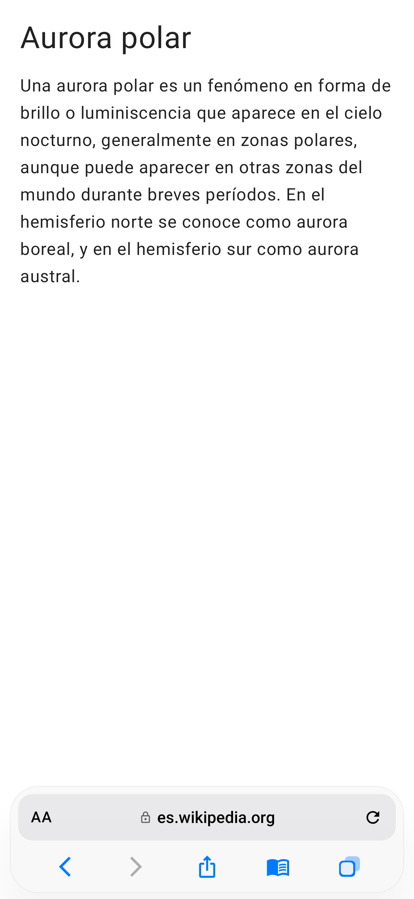
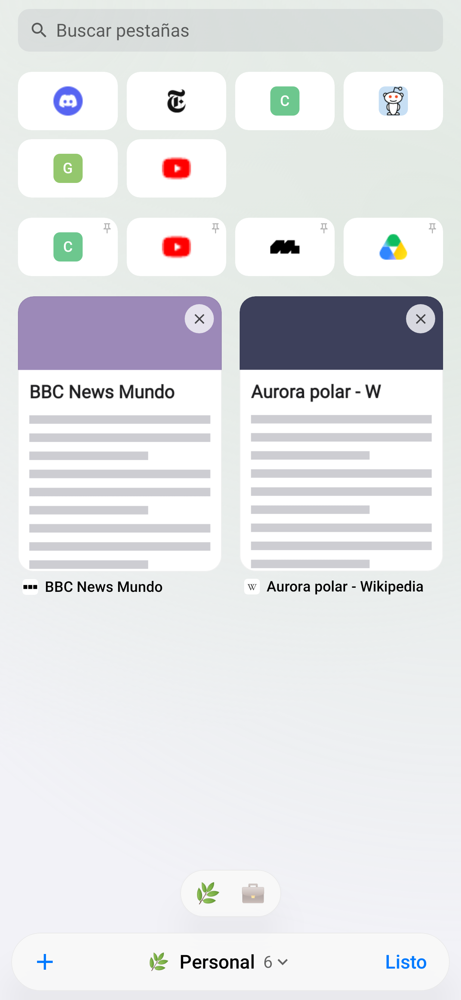
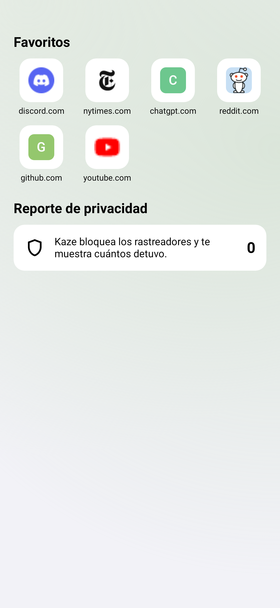
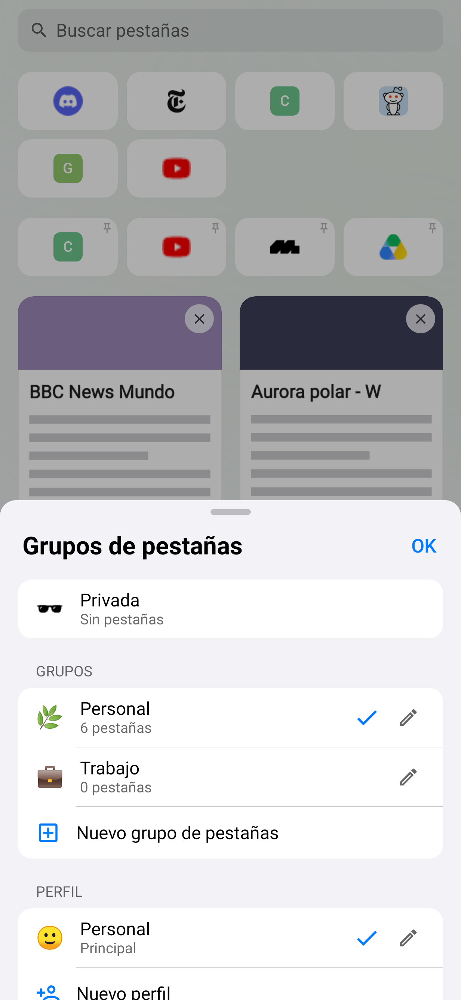

# Kaze para Android

Kotlin + Jetpack Compose sobre **GeckoView 158** (el motor de Firefox para Android), con el
**aspecto de Safari** y las **funciones de Zen**: espacios, Essentials, fijadas y pestañas que se duermen.

<p>
  
  
  
  
</p>

## Cómo se usa

- **Barra abajo (como Safari):** dirección en una cápsula con **AA** (lector, traducir, tamaño del texto,
  versión de escritorio, reporte de privacidad, ocultar barra) y recargar. Debajo: atrás, adelante,
  compartir, biblioteca y pestañas. Al bajar por la página se encoge; un toque la abre otra vez.
  **Desliza la barra a los lados** para pasar a la pestaña anterior o siguiente.
- **Vista de pestañas:** tarjetas con miniatura de cada página, buscar pestañas, Essentials y fijadas arriba.
  Abajo, los emojis de tus espacios; **desliza a los lados** para cambiar de espacio (como Zen).
  Mantén presionado el botón de pestañas para nueva, privada o cerrar.
- **Grupos (espacios de Zen):** toca el nombre del grupo abajo para cambiar, crear o editar grupos
  (nombre, emoji, colores, aislar cookies) y **perfiles**.
- **Perfiles:** cada uno con sus grupos, Essentials, historial, lista de lectura y cookies propias.
- **Página de inicio:** Favoritos (tus Essentials), visitados con frecuencia, lista de lectura y reporte de privacidad.
  No carga el motor de Firefox hasta que abres algo: no gasta RAM.
- **Lector y traducir:** lector limpio con temas y tamaño de letra; traducción de la página hecha **en el
  propio teléfono** con el traductor de Firefox (la primera vez descarga el idioma).
- **Biblioteca:** Favoritos, Lista de lectura e Historial.

## Instalar y actualizar

Cada cambio que se sube a `main` se compila y se publica en **[Releases](https://github.com/Saerling/kaze/releases)**
como `android-<número>`. Instala el `.apk` de tu procesador (`arm64-v8a` en casi todos los celulares).

Después de eso **no hace falta volver a GitHub**: al abrir Kaze revisa si hay una versión nueva
(como mucho cada 3 horas) y muestra *Nueva versión disponible* → **Actualizar** la descarga y la
instala encima, sin desinstalar ni perder pestañas. También en **Ajustes → Buscar actualizaciones ahora**.
La primera vez Android pide permitir que Kaze instale apps ("Permitir de esta fuente").

### Firma (por qué ya no hay que desinstalar)

Android solo acepta un APK como actualización si viene firmado con **la misma clave**. Todas las
versiones se firman con `keystore/kaze-release.p12`; su contraseña está guardada como secreto de
GitHub (`KAZE_KEYSTORE_PASSWORD`, en *Settings → Secrets and variables → Actions*), nunca en el código.
Guarda una copia de esa contraseña: sin ella no se pueden publicar actualizaciones que instalen encima.

Compilar en tu PC sin la contraseña firma con la clave de depuración (sirve para probar,
pero ese APK no se instala encima del publicado).

O desde Android Studio: abre la carpeta `android/` y dale ▶. Necesita el SDK con la plataforma **37.2**.

```bash
cd android
./gradlew testDebugUnitTest   # pruebas + capturas en docs/capturas/
./gradlew assembleDebug       # APKs en app/build/outputs/apk/debug/
```

## Cómo se usa

- **Pantalla de espacios** (la de inicio): arriba historial, búsqueda y ajustes; luego Essentials,
  el espacio actual con sus fijadas y pestañas, y los emojis de los espacios abajo.
  **Desliza a los lados** para cambiar de espacio. Toca el nombre del espacio para editarlo.
- **Mantén presionada una pestaña**: Essentials, fijar, mover a otro espacio, reordenar, cerrar.
- **Navegador**: arriba la dirección (tócala para buscar); abajo atrás/adelante y, a la derecha,
  volver a los espacios y el menú (nueva, privada, buscar en la página, compartir, versión de escritorio…).
  Los controles se esconden al bajar por la página y vuelven al subir.
- **Espacios aislados**: en el editor del espacio, "Aislar este espacio" le da cookies propias
  (dos cuentas del mismo sitio en espacios distintos).

## Memoria

Detalle en [docs/ARQUITECTURA.md](../docs/ARQUITECTURA.md#ahorro-de-memoria). En resumen: solo 1–3
pestañas tienen la página cargada (según la RAM del teléfono, configurable en Ajustes); las demás
se duermen y se restauran al volver, con su historial y posición.

## Estructura

```
app/src/main/java/app/kaze/browser/
├── KazeApp.kt            Application (no crea nada: ver el arreglo del cierre) + contenedor Kaze
├── MainActivity.kt       GeckoView único, navegación entre pantallas, permisos, archivos, intents
├── engine/
│   ├── Engine.kt         GeckoRuntime y preferencias de Gecko de bajo consumo
│   ├── SessionPool.kt    sesiones por pestaña: cargar, dormir, restaurar, delegados de Gecko
│   ├── BrowserUi.kt      diálogos, permisos, menú contextual, pantalla completa, avisos
│   ├── Downloads.kt      descargas a la carpeta Descargas
│   └── Updater.kt        actualizaciones desde GitHub Releases (descarga + instalación)
├── data/
│   ├── Models.kt         Space, Tab, TabKind (Essential / Pinned / Normal)
│   ├── Store.kt          estado de espacios y pestañas + paleta de colores
│   ├── Db.kt             SQLite: espacios, pestañas, historial
│   ├── Settings.kt       ajustes
│   ├── Urls.kt           dirección vs. búsqueda, motores de búsqueda
│   └── Net.kt            sugerencias de búsqueda e íconos de sitios
└── ui/
    ├── theme/Theme.kt    papel y tinta, tarjetas, efecto al tocar
    ├── components/       fondo con degradado, Essentials, filas, selector de espacios
    ├── screens/          espacios, barra del navegador, búsqueda
    └── sheets/           menús, editor de espacios, historial, ajustes, diálogos de páginas
```
