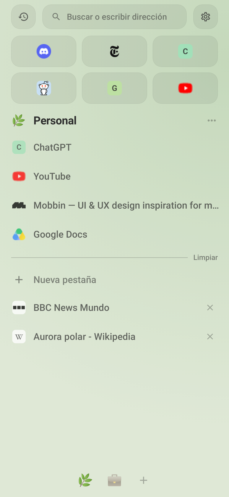
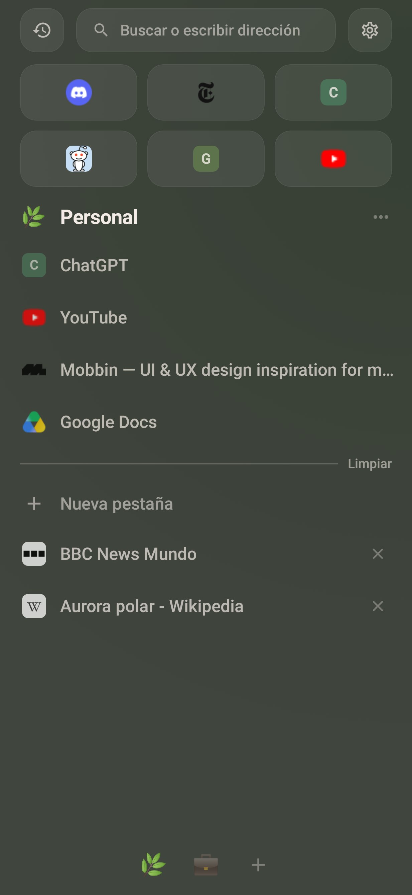
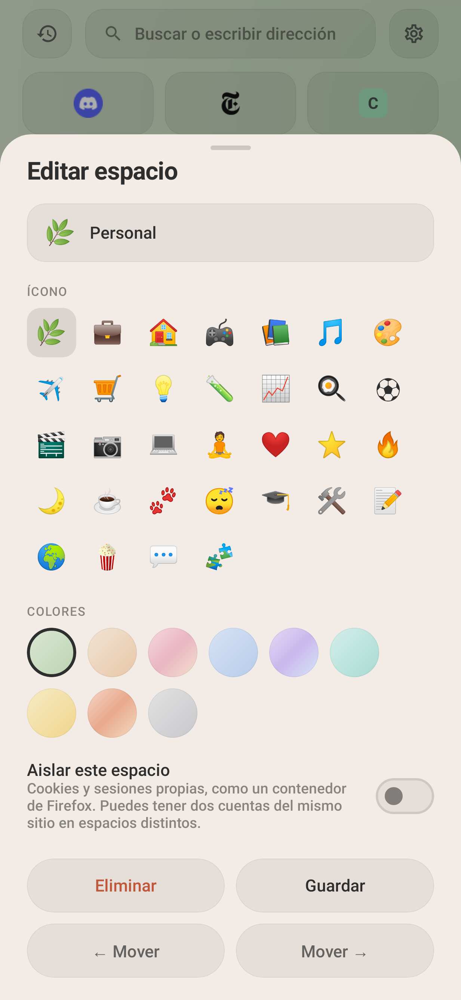

# Kaze para Android

Kotlin + Jetpack Compose sobre **GeckoView 158** (el motor de Firefox para Android), con la
estética de Z-Sync: papel y tinta, degradado por espacio, Essentials y controles flotantes.

<p>
  
  
  
  
</p>

## Instalar

En GitHub: pestaña **Actions** → último run de **Android** → *Artifacts* → `kaze-android-arm64-v8a`
(casi todos los celulares; `armeabi-v7a` para los muy viejos). Descomprime e instala el `.apk`.

O desde Android Studio: abre la carpeta `android/` y dale ▶. Necesita el SDK con la plataforma **37.2**.

```bash
cd android
./gradlew testDebugUnitTest   # pruebas + capturas en docs/capturas/
./gradlew assembleDebug       # APKs en app/build/outputs/apk/debug/
```

## Cómo se usa

- **Pantalla de espacios** (la de inicio): arriba historial, búsqueda y ajustes; luego Essentials,
  el espacio actual con sus fijadas y pestañas, y los emojis de los espacios abajo.
  **Desliza a los lados** para cambiar de espacio. Toca el nombre del espacio para editarlo.
- **Mantén presionada una pestaña**: Essentials, fijar, mover a otro espacio, reordenar, cerrar.
- **Navegador**: arriba la dirección (tócala para buscar); abajo atrás/adelante y, a la derecha,
  volver a los espacios y el menú (nueva, privada, buscar en la página, compartir, versión de escritorio…).
  Los controles se esconden al bajar por la página y vuelven al subir.
- **Espacios aislados**: en el editor del espacio, "Aislar este espacio" le da cookies propias
  (dos cuentas del mismo sitio en espacios distintos).

## Memoria

Detalle en [docs/ARQUITECTURA.md](../docs/ARQUITECTURA.md#ahorro-de-memoria). En resumen: solo 1–3
pestañas tienen la página cargada (según la RAM del teléfono, configurable en Ajustes); las demás
se duermen y se restauran al volver, con su historial y posición.

## Estructura

```
app/src/main/java/app/kaze/browser/
├── KazeApp.kt            Application (no crea nada: ver el arreglo del cierre) + contenedor Kaze
├── MainActivity.kt       GeckoView único, navegación entre pantallas, permisos, archivos, intents
├── engine/
│   ├── Engine.kt         GeckoRuntime y preferencias de Gecko de bajo consumo
│   ├── SessionPool.kt    sesiones por pestaña: cargar, dormir, restaurar, delegados de Gecko
│   ├── BrowserUi.kt      diálogos, permisos, menú contextual, pantalla completa, avisos
│   └── Downloads.kt      descargas a la carpeta Descargas
├── data/
│   ├── Models.kt         Space, Tab, TabKind (Essential / Pinned / Normal)
│   ├── Store.kt          estado de espacios y pestañas + paleta de colores
│   ├── Db.kt             SQLite: espacios, pestañas, historial
│   ├── Settings.kt       ajustes
│   ├── Urls.kt           dirección vs. búsqueda, motores de búsqueda
│   └── Net.kt            sugerencias de búsqueda e íconos de sitios
└── ui/
    ├── theme/Theme.kt    papel y tinta, tarjetas, efecto al tocar
    ├── components/       fondo con degradado, Essentials, filas, selector de espacios
    ├── screens/          espacios, barra del navegador, búsqueda
    └── sheets/           menús, editor de espacios, historial, ajustes, diálogos de páginas
```
