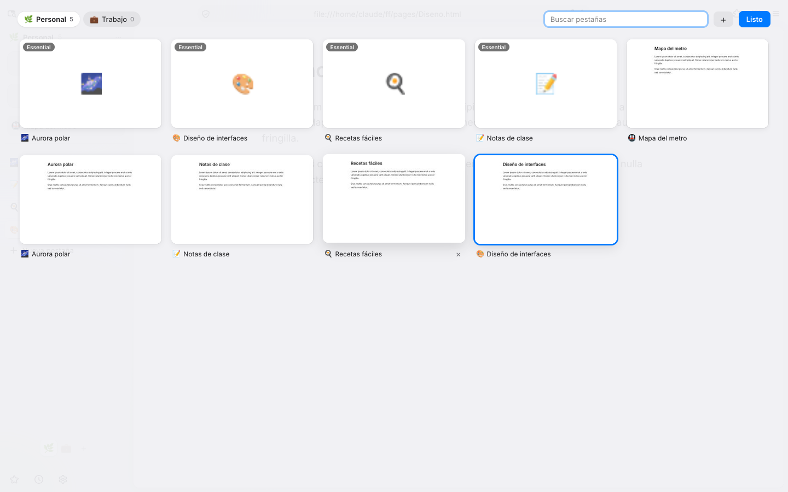
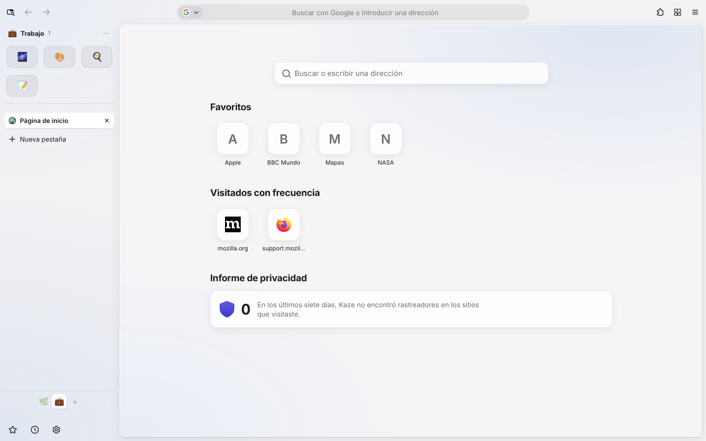

# Kaze para Windows

Las funciones de Zen (espacios, Essentials, modo compacto, pestañas que se duermen) con la
estética de Safari, sobre Firefox 158.


 

## Instalar

1. Descarga **`Kaze-0.4.N-setup.exe`** de [Releases](https://github.com/Saerling/kaze/releases)
   (la versión `windows-N` más reciente).
2. Ábrelo. Si Windows muestra "Windows protegió su PC", toca **Más información → Ejecutar de todas formas**
   (el instalador no está firmado con un certificado de pago).
3. Listo: Kaze queda en el menú Inicio y en el escritorio. No hace falta ser administrador.

Cuando sale una versión nueva, Kaze lo avisa arriba de la ventana: **Actualizar** la descarga,
y **Reiniciar y actualizar** la instala encima y vuelve a abrir Kaze, sin perder nada.

Kaze tiene su propia carpeta de datos (`%APPDATA%\Kaze`), separada de Firefox si lo tienes instalado.

## Qué tiene

| | |
|---|---|
| **Espacios** | Cada pestaña pertenece a un espacio (emoji, nombre y color). Selector abajo en la barra lateral, rueda del ratón sobre los emojis o `Ctrl+Alt+←/→`. |
| **Essentials** | Mosaicos arriba, visibles en todos los espacios del perfil. Clic derecho en una pestaña → *Añadir a Essentials*. |
| **Perfiles** | Grupos de espacios con sus propias cookies y sesiones (un contenedor de Firefox por perfil): por ejemplo, tu cuenta de Google personal en uno y la del trabajo en otro. Botón del perfil abajo a la izquierda. |
| **Todas las pestañas** | Tarjetas con miniatura, como en Safari. Botón ▦ arriba a la derecha o `Ctrl+Mayús+\`. Buscar, cambiar de espacio, cerrar. |
| **Menú aA** | En la barra de dirección: tamaño del texto, Lector, Traducir (en el propio equipo, sin enviar la página a nadie), buscar en la página, lista de lectura, favoritos, compartir, informe de privacidad, ocultar barras. |
| **Página de inicio** | Favoritos (la barra de marcadores), sitios frecuentes, lista de lectura y rastreadores bloqueados en la semana. |
| **Modo compacto** | Barra lateral y barra de dirección ocultas hasta pasar el ratón (`Ctrl+Alt+C`). |
| **Poca RAM** | Las pestañas sin usar se duermen a los 20 min y al faltar memoria; menos procesos y cachés más pequeñas que Firefox; las miniaturas son JPEG pequeños y solo de pestañas abiertas. |
| **Privacidad** | Bloqueo de rastreadores estricto, sin telemetría ni estudios, sin contenido patrocinado. |

En Windows 11 el fondo de la ventana es acrílico (translúcido, como Safari en macOS).

## Atajos

| | |
|---|---|
| `Ctrl+Alt+1…9` | ir al espacio 1…9 del perfil |
| `Ctrl+Alt+←` / `→` | espacio anterior / siguiente |
| `Ctrl+Mayús+\` | todas las pestañas |
| `Ctrl+Alt+C` | modo compacto |
| `Ctrl+Alt+R` | Lector |
| Clic derecho en una pestaña | Añadir a Essentials · Mover a espacio |
| Clic derecho en un emoji / `⋯` | renombrar, ícono, colores, mover, eliminar espacio |

Preferencias en `about:config`: `kaze.unloader.minutes` (dormir pestañas, por defecto 20),
`kaze.theme.floating` (página flotante), `kaze.compact.enabled`, `kaze.startpage.enabled`.

## Cómo se arma el instalador

Compilar Firefox entero tarda horas y pide un PC potente, así que el instalador se arma sobre el
**Firefox oficial de Mozilla** (en español) y le pone Kaze encima, en unos minutos
([`scripts/empaquetar_windows.py`](scripts/empaquetar_windows.py)):

- **Identidad propia**: `browser/application.ini` con `Name=Kaze`; los accesos directos abren
  `firefox.exe -app browser\application.ini`, así Kaze tiene su carpeta de perfiles y nunca toca la de Firefox.
- **Marca**: nombre "Kaze" e íconos dentro de `browser/omni.ja` y en la ventana.
- **Interfaz**: la carpeta `kaze/` (la misma de `src/browser/kaze/`) se registra como `chrome://kaze/`
  con un cargador autoconfig ([`src/browser/kaze/cargador.cfg`](src/browser/kaze/cargador.cfg)).
- **Actualizaciones**: el actualizador de Mozilla queda desactivado (políticas); Kaze se actualiza
  desde las versiones `windows-N` de GitHub Releases.
- **Instalador** NSIS ([`windows/kaze.nsi`](windows/kaze.nsi)) por usuario, en `%LOCALAPPDATA%\Programs\Kaze`.

GitHub Actions ([`.github/workflows/desktop.yml`](../.github/workflows/desktop.yml)) lo hace con cada
cambio en `desktop/` y publica el `.exe` en Releases. Para armarlo a mano (en Linux, con `p7zip-full` y `nsis`):

```bash
curl -LO "https://archive.mozilla.org/pub/firefox/releases/158.0.1/win64/es-MX/Firefox%20Setup%20158.0.1.exe"
python3 desktop/scripts/empaquetar_windows.py --setup "Firefox Setup 158.0.1.exe" --build 1
```

Todavía no se puede poner Kaze como navegador predeterminado de Windows (los enlaces de otras apps
abren tu navegador de siempre).

## Probar sin compilar

El cargador de desarrollo pone la interfaz de Kaze sobre tu Firefox normal (158 o cercano):

```bash
# Windows: abre la terminal como administrador
python desktop\dev\instalar.py "C:\Program Files\Mozilla Firefox"
```

Luego abre Firefox con un perfil nuevo (`firefox -P` → *Crear perfil* → "kaze") para no tocar el tuyo.
Al editar `kaze.js` o `kaze.css`, reinicia Firefox para ver los cambios.
Para quitarlo: `python desktop\dev\instalar.py "C:\Program Files\Mozilla Firefox" --quitar`.

## Compilar

Compilar Firefox es pesado: **16 GB de RAM** (32 GB ideal), **~60 GB libres** en SSD y
de 1 a 3 horas la primera vez (luego los cambios en `kaze.js`/`kaze.css` tardan segundos).

### En Windows

1. Instala [MozillaBuild](https://firefox-source-docs.mozilla.org/setup/windows_build.html#mozillabuild),
   [Git](https://git-scm.com/download/win) y [Node.js 22+](https://nodejs.org/).
2. Abre `C:\mozilla-build\start-shell.bat` (la terminal de Mozilla) y:

```bash
cd /c/ruta/a/kaze/desktop
python scripts/check.py     # comprobar que todo aplica (segundos)
npm install
npm run init                # descarga Firefox 158, aplica Kaze e instala herramientas (la 1.ª vez tarda)
npm run build               # compilar
npm start                   # abrir Kaze
npm run package             # instalador/zip en dist/
```

Para builds de publicación (más optimizadas, compilan más lento): `KAZE_RELEASE=1 npm run build`.

Si el PC se queda sin memoria al compilar, descomenta `MOZ_MAKE_FLAGS="-j4"` en `configs/common/mozconfig`.

### Cambios rápidos en la interfaz

Tras la primera compilación, al tocar solo `kaze.js`, `kaze.css` o `kaze-prefs.js`:

```bash
cd engine && ./mach build faster && ./mach run
```

## Actualizar a una versión nueva de Firefox

1. Cambia `version` y `candidate` en `surfer.json`.
2. `python scripts/check.py` — si un parche no aplica, dice cuál (son 3 cambios de pocas líneas, fáciles de rehacer).
3. `npm run download && npm run import && npm run build`.

## Cómo encaja con Zen

Kaze toma las ideas de Zen (espacios, Essentials, compacto, página flotante) y su herramienta
de compilación (`surfer`), pero el código es propio y mucho más pequeño: en lugar de reemplazar
la barra de pestañas de Firefox, se monta sobre las pestañas verticales que Firefox ya trae.
Detalles en [docs/ARQUITECTURA.md](../docs/ARQUITECTURA.md).
